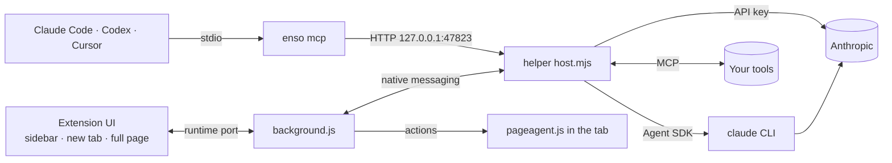

# Ensō

Ensō is a personal assistant built into the [Zen browser](https://zen-browser.app).
It puts a chat in the sidebar, a search-or-ask box and widgets on every new tab,
and an agent that can read and act on web pages. It runs Claude on your own
Claude subscription (through Claude Code) or on an Anthropic API key, uses the
tools you connect (mail, calendar, GitHub, any MCP server), and keeps what it
remembers in files on your Mac. Other agents on the same Mac (Claude Code,
Codex, Cursor) can use Zen through it too.

Website and user docs: <https://enso.wicker.life>. Licence: MIT, see [LICENSE](LICENSE).

<picture>
  <source media="(prefers-color-scheme: dark)" srcset="https://enso.wicker.life/screenshots/act-dark-1600.webp">
  
</picture>

## Contents

- [Install](#install)
- [Quick start](#quick-start)
- [Features](#features)
- [How it is built](#how-it-is-built)
- [Repository layout](#repository-layout)
- [Development](#development)
- [Documentation](#documentation)

## Install

```sh
curl -fsSL https://enso.wicker.life/install.sh | bash
```

macOS only for now. You need:

- Zen (or Firefox 139 or newer);
- [Node.js](https://nodejs.org) 18 or newer;
- for the default engine, [Claude Code](https://docs.anthropic.com/en/docs/claude-code/setup)
  installed and signed in once (`claude`). Without it you can use an Anthropic API key.

The installer ([`scripts/install.sh`](scripts/install.sh)) downloads the helper
listed at `https://enso.wicker.life/api/latest`, checks its SHA-256, installs it
in `~/Library/Application Support/Enso/helper`, registers it with Zen and
Firefox, writes the `enso` command, offers to let Claude Code use Zen, and opens
the signed extension in Zen. It needs no `sudo` and never touches your data.
Run it again to update the helper; the extension updates itself.

Step by step, with what each permission is for: [docs/help/getting-started.md](site/content/docs/install.md).

## Quick start

1. Press <kbd>⌘E</kbd> in Zen to open the sidebar. The first time, Ensō asks
   your name, a few lines about you and, optionally, what each Zen space is for.
2. Ask something about the page you are on: "summarise this", "fill in this
   form with my address". The page is attached by default (the page chip).
3. Open a new tab. Type a site, a search or a question in the box; choose
   **Add widgets** for your calendar, tasks, mail or GitHub at a glance.
4. Optional: let other agents use Zen.

   ```sh
   enso mcp install        # registers zen-browser with Claude Code, Codex and Cursor (those installed)
   enso mcp status
   ```

## Features

| Area | What it does | More |
|---|---|---|
| Sidebar chat | Claude next to the page, with the page, mentioned tabs (`@`), files (up to 25 MB) and screenshots as context; slash commands (`/summarize`, `/reply`, your own). | [help](site/content/docs/sidebar.md) |
| New tab | One box that opens sites, searches with your default engine, or asks Ensō; widgets you add and arrange. | [help](site/content/docs/new-tab.md) |
| Widgets | Next up, Due soon, Tasks (from task apps such as Commonfold), Mail, Practice, GitHub, Clock, Recent chats, Quick links, Note, Ask. | [help](site/content/docs/widgets.md) |
| Acting on pages | Read, click, type, select, press keys, scroll, navigate, go back, screenshot. What you ask for runs; steps Claude proposes and anything irreversible ask first. | [help](site/content/docs/acting-on-pages.md) |
| Tools | claude.ai connectors and Claude Code's MCP servers (subscription engine), MCP servers Ensō signs in to itself (OAuth), and built-in GitHub across all your orgs. | [help](site/content/docs/tools.md) |
| Zen spaces | Conversations, memory, tab tools and notes per Zen space, detected from each space's container. | [help](site/content/docs/spaces.md) |
| Developer tools | Console, network log, JavaScript and storage keys of a tab; requests with your signed-in session on sites you allow; a separate headless Zen for testing. | [help](site/content/docs/session-access.md) |
| Other agents | A local MCP server, `zen-browser`, that Claude Code, Codex, Cursor and others reach through the `enso mcp` launcher. 44 tools; a read-only scope. | [docs/mcp.md](docs/mcp.md) |
| Memory and history | `profile.md` and `memory.md` you can edit, per-space memory, every conversation with its tool calls, a per-site activity log, reports with charts. | [data model](docs/data-model.md) |
| Safety | Banking, payment, password-manager and health sites are never read or acted on; cookie values and tokens are never returned to Claude; every action is logged. | [security](docs/security.md) |

<picture>
  <source media="(prefers-color-scheme: dark)" srcset="https://enso.wicker.life/screenshots/sidebar-tools-dark.webp">
  
</picture>

## How it is built

Two parts, installed together:

- **The extension** (`extension/`, id `enso@wicker.life`, Manifest V2 for
  Firefox/Zen) is the interface: one app (`ui/`) shown in the sidebar, the new
  tab, a full page and report tabs. `background.js` connects to the helper and
  carries out page and browser actions; `pageagent.js` is injected into a tab
  to read it and act on it.
- **The helper** (`helper/`, Node.js 18+) is a native-messaging host (`enso`)
  that Zen starts when the extension connects. It owns all state, runs each
  chat turn on the subscription engine (Claude Agent SDK on your `claude` CLI)
  or the API engine (Messages API), signs in to MCP servers, and serves the
  `zen-browser` MCP server on `127.0.0.1:47823`.



Details: [docs/architecture.md](docs/architecture.md).

## Repository layout

| Path | What it is |
|---|---|
| `extension/` | The extension: `manifest.json`, `background.js`, `pageagent.js`, the HTML entry points (`sidebar.html`, `newtab.html`, `full.html`, `report.html`, `app.html`) and the UI in `ui/` (`ui/mock.js` is an in-page mock helper for working on the UI without Zen). |
| `helper/` | The helper: `host.mjs` (message handling), `lib/` (engines, tools, MCP server, connections, storage), `bin/enso.mjs` (the `enso` command), `config.json` (shipped defaults), `test/`. |
| `docs/` | Developer documentation, decision records and plans. Start at [docs/README.md](docs/README.md). |
| `site/` | enso.wicker.life: website, help centre (`site/content/docs/`, the user guides), update feed, release downloads and sync server. SvelteKit; see [site/README.md](site/README.md). |
| `scripts/install.sh` | The release installer: a symlink to `site/static/install.sh`, served at `enso.wicker.life/install.sh`. |
| `scripts/dev.sh` | Run Ensō from this checkout. |
| `scripts/pack-helper.sh` | Build the helper tarball for a release. |
| `.github/workflows/` | `ci.yml` (checks on pushes to `main` and on pull requests) and `release.yml` (signs and publishes on a `v*` tag). |

## Development

```sh
scripts/dev.sh --open            # helper deps, manifests pointing at this checkout, unsigned build/enso-dev.xpi, open in Zen
cd helper && npm test            # offline tests
python3 -m http.server -d extension 8000   # UI on a mock helper: http://127.0.0.1:8000/full.html
```

Unsigned builds need `xpinstall.signatures.required = false` in `about:config`.
Everything else, including debugging the helper and Marionette: [docs/development.md](docs/development.md).
Releases: [docs/releasing.md](docs/releasing.md).

## Documentation

| Page | What it covers |
|---|---|
| [docs/README.md](docs/README.md) | Index of everything below. |
| [Architecture](docs/architecture.md) | The extension's pages, background.js, the page agent, native messaging, the helper's modules, data flow. |
| [Data model](docs/data-model.md) | Every file in the data folder, Keychain items, extension storage, the Zen Chat migration. |
| [Security](docs/security.md) | Threat model, approvals, session access, private sites, the MCP server's defences, secrets, OAuth. |
| [Privacy](docs/privacy.md) | What stays on your Mac and what leaves it, matched to the site's privacy policy. |
| [MCP](docs/mcp.md) | Using Zen from Claude Code, Codex, Cursor and others; the tool reference. |
| [Development](docs/development.md) | Setup, tests, mock UI, debugging. |
| [Releasing](docs/releasing.md) | Versions, tags, signing, the update feed. |
| [Protocol](docs/PROTOCOL.md) | The message contract between the UI, background.js and the helper. |
| [User help](site/content/docs/) | Guides for people using Ensō. |
| [CHANGELOG.md](CHANGELOG.md) | What changed in each release. |
