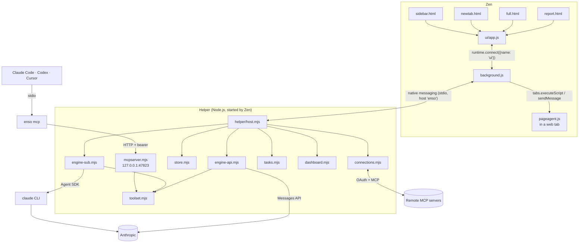
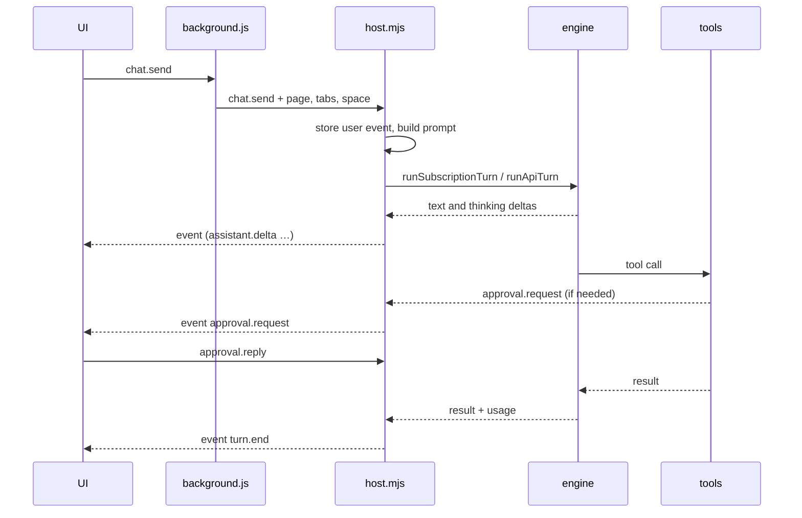
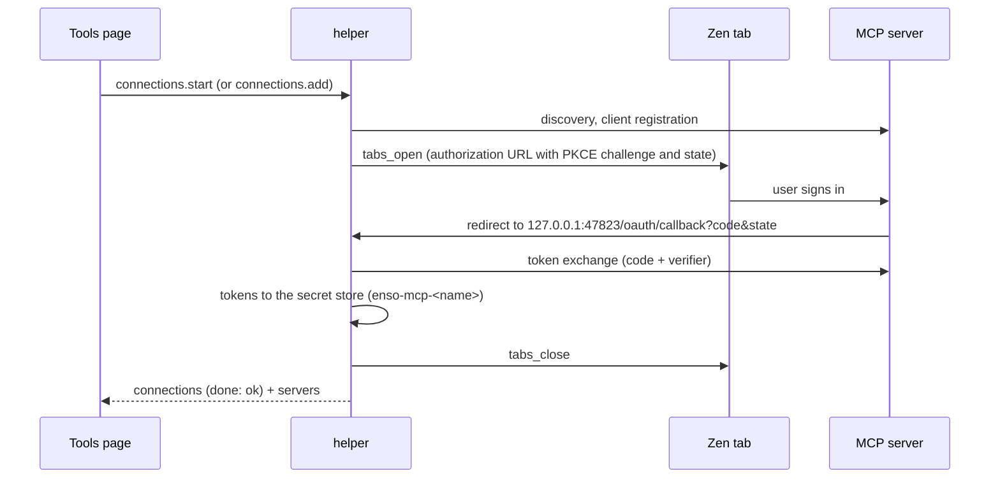
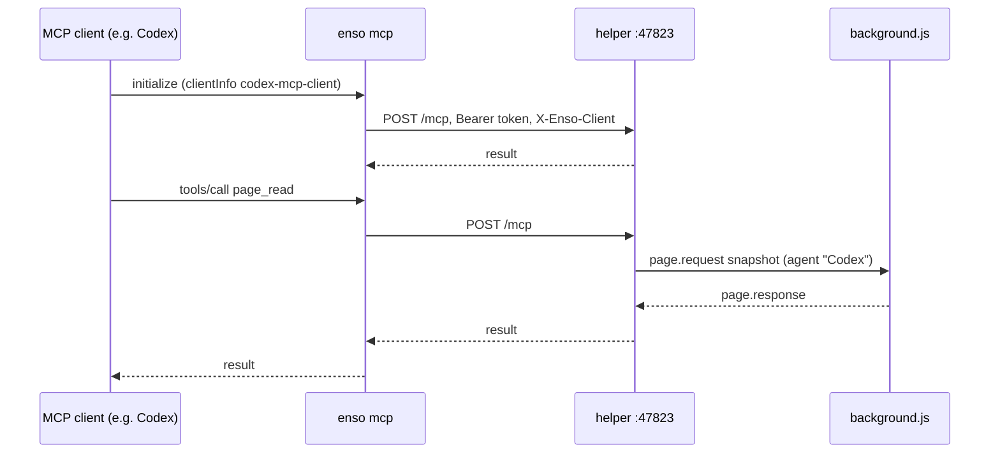
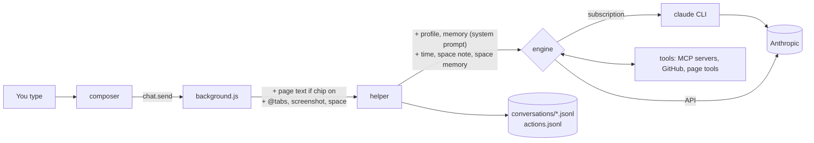

# Architecture

How Ensō is put together: the extension and its pages, the helper and its
modules, and how a message, a page action and an MCP call travel between them.
The exact message shapes are in [PROTOCOL.md](PROTOCOL.md); where data is
stored is in [data-model.md](data-model.md).

## Contents

- [Overview](#overview)
- [The extension](#the-extension)
- [Native messaging](#native-messaging)
- [The helper](#the-helper)
- [Engines](#engines)
- [Tools](#tools)
- [Connections and OAuth](#connections-and-oauth)
- [The zen-browser MCP server and `enso mcp`](#the-zen-browser-mcp-server-and-enso-mcp)
- [Dashboard, tasks and GitHub](#dashboard-tasks-and-github)
- [Headless Zen and Marionette](#headless-zen-and-marionette)
- [Zen spaces](#zen-spaces)
- [Data flow](#data-flow)
- [Ports, paths and environment variables](#ports-paths-and-environment-variables)

## Overview



The extension has no state of its own beyond a few UI preferences. The helper
owns everything: conversations, memory, settings, the dashboard, sign-ins. Every
UI that is open (sidebar, new tab, full page) connects to `background.js` and
receives every broadcast, so they stay in sync.

## The extension

`extension/manifest.json`: Manifest V2, id `enso@wicker.life`, minimum Firefox
139. Permissions: `nativeMessaging`, `tabs`, `tabGroups`, `history`, `menus`,
`storage`, `bookmarks`, `search`, `cookies`, `contextualIdentities`,
`webRequest`, `webNavigation` and `<all_urls>`.

### Pages

All pages load the same app (`ui/app.js`) and pick a mode from the HTML entry point.

| Page | Where it shows | What it is |
|---|---|---|
| `sidebar.html` | Zen's sidebar (`sidebar_action`, <kbd>⌘E</kbd> or <kbd>Ctrl+E</kbd>, or the toolbar button) | Chat next to the page, with history and settings behind icons. |
| `newtab.html` | Every new tab and the home page (`chrome_url_overrides.newtab`, `chrome_settings_overrides.homepage`) | The search-or-ask box, the "Your tools" strip and widgets. |
| `full.html` | A normal tab ("Open Ensō as a page" in the toolbar button's context menu) | Three columns: navigation (Home, Activity, Tools, Settings, conversations, reports), the chat, and a context panel (page, pages in this conversation, actions, memory). |
| `report.html?id=…` | A tab opened by `create_report` | One report, Markdown with fenced `chart` blocks drawn by `ui/chart.js`. |
| `app.html` | Not linked from the manifest | The same app without `data-mode`, so it takes the mode from `?mode=` (default `sidebar`). |

The UI modules:

| Module | Role |
|---|---|
| `ui/app.js` | Builds the shell for the mode, the top bar, banners, keyboard shortcuts. |
| `ui/store.js` | The UI's state and actions; applies messages from the helper. |
| `ui/transport.js` | The port to `background.js`, or the mock when not running as an extension. |
| `ui/mock.js` | An in-page fake helper with a fictional user ("Maya"), for working on the UI without Zen. |
| `ui/omnibox.js` | Suggestions for the new-tab box: URL completion, search, open tabs, bookmarks, history, "Ask Ensō". |
| `ui/markdown.js`, `ui/chart.js`, `ui/format.js`, `ui/dom.js`, `ui/icons.js`, `ui/prompts.js` | Rendering helpers; `prompts.js` holds the per-site suggestions in the composer. |
| `ui/views/*` | `chat`, `composer`, `newtab`, `widgets`, `dashboard`, `history` (history and Activity), `tools`, `settings`, `onboarding`, `panels` (full-page columns), `report`, `tips`. |

### background.js

`background.js` is the only part that talks to the helper. It:

- opens the native port with `browser.runtime.connectNative("enso")` and
  reconnects on demand; when the port drops it broadcasts a `host_disconnected`
  error, which the UI shows as "The chat helper stopped" with a Reconnect button;
- relays UI messages to the helper and broadcasts every helper message to all UIs;
- adds context to `chat.send`: the active tab's id, URL and title, its text when
  the page chip is on, a screenshot when asked, the text of `@`-mentioned tabs
  (up to 20), and the current Zen space;
- answers `tabs.list` and `page.current` itself;
- carries out `page.request` and `browser.request` from the helper (below);
- records network requests for every web tab (`webRequest`, ring buffer of 500
  per tab, secret-looking header and query values redacted, never bodies) and
  keeps console entries for tabs where capture was started (up to 1000 per tab,
  re-armed at each navigation with `webNavigation.onCommitted`);
- swaps a freshly opened new tab for an identical one so the keyboard focus
  lands in Ensō's box instead of the address bar;
- adds two context-menu items: "Open Ensō as a page" (toolbar button) and "Ask
  Ensō about this" (selection, link or page), which opens the sidebar and
  pre-fills the composer.

The private-site list (`sensitiveHosts`) arrives with the helper's `state`
message; until then `background.js` uses `*bank*`, `*health*` and `*patient*`.
On a private site it sends no page text or screenshot and refuses page actions.

### pageagent.js

A content script injected into a tab on first use (`tabs.executeScript`,
`document_idle`; at `document_start` when console capture is armed). It answers
`{ enso: true, action, args }` messages:

- `snapshot` and `text`: visible text plus a numbered list of interactive
  elements (links, buttons, inputs, ARIA widgets); the numbers are the `ref`s
  the page tools use;
- `click`, `type`, `select`, `press`, `scroll`: performed on the element with
  that `ref`. `type` selects the editor's contents and inserts through the
  browser's editing path, with paste as a fallback, so rich editors (Outlook's,
  for example) see the input;
- `console`, `eval`, `storage`: console capture and evaluation in the page's own
  JS world (`window.wrappedJSObject` and `exportFunction`), and storage keys.
  Credential-looking values are redacted before they leave the page.

While a turn acts on a page, the agent flashes a soft outline on the element it
touches and shows a pill at the top of the page: "✦ Claude is working on this
page", or the MCP client's name when another agent is acting. For an external
agent with a live session the pill stays for the whole session ("✦ Codex · Fix
the failing checkout test", with Paused/Stopped states), the page title gets a
"✦ " prefix (followed through title rewrites with a MutationObserver, restored
exactly), and clicking the pill opens Ensō's sidebar through `pill.html`, an
extension frame laid over it. On Google Docs, `type` without a ref inserts into
Docs' hidden input frame.

## Native messaging

Zen starts the helper when the extension connects, using the manifest
`enso.json`. Where the browser finds it depends on the system
(`nativeHostDirs()` in `lib/platform.mjs`, and the installers):

| System | Manifest | Launcher (`path`) |
|---|---|---|
| macOS | `~/Library/Application Support/Mozilla/NativeMessagingHosts/` and `~/Library/Application Support/zen/NativeMessagingHosts/` | `<data>/helper/run.sh` |
| Linux | `~/.mozilla/native-messaging-hosts/` and `~/.zen/native-messaging-hosts/` (Zen reads Mozilla's folder for now, zen-browser/desktop#10622) | `<data>/helper/run.sh` |
| Windows | `%APPDATA%\Enso\enso.json`, found through the registry key `HKCU\Software\Mozilla\NativeMessagingHosts\enso` (Zen reads Mozilla's key) | `%APPDATA%\Enso\bin\run.cmd` |

```json
{ "name": "enso", "path": ".../Enso/helper/run.sh", "type": "stdio", "allowed_extensions": ["enso@wicker.life"] }
```

The launcher runs `host.mjs` with an absolute path to `node`, because Zen
starts programs with a minimal environment. On Windows `run.cmd` lives in
`bin\`, outside `helper\`, so a running helper never holds the folder an
update replaces; its stderr goes to `%LOCALAPPDATA%\Enso\Logs\helper-stderr.log`.
On macOS and Linux `run.sh` appends stderr to `helper.log`. Messages are framed as a 4-byte
little-endian length followed by UTF-8 JSON (`lib/native.mjs`); a frame to the
browser must stay under 1 MB, so larger messages (up to 64 MB) go as `chunk`
frames that `extension/transfer.js` reassembles
([PROTOCOL.md](PROTOCOL.md#chunked-messages)); files for `page_upload` stream in
512 KiB `upload_chunk` requests instead. Nothing else may be written to stdout; the helper
logs to stderr with an `[enso]` prefix. The helper exits when stdin closes,
which happens when Zen quits.

## The helper

`helper/host.mjs` handles every message from the extension (see the table in
[PROTOCOL.md](PROTOCOL.md#ui--host)), runs chat turns, and starts the MCP
server. On start it also puts the usual install folders in front of `PATH`
(`extraPath()` in `lib/platform.mjs`: `~/.volta/bin`, `~/.local/bin` and
Homebrew on macOS and Linux, `/snap/bin` on Linux, npm's and Node's folders on
Windows), and removes temporary profiles left by a headless Zen from an
earlier crash.

| Module | Role |
|---|---|
| `lib/store.mjs` | The data folder: settings, profile, memory, conversations, events, actions log, reports, dashboard, engine state. Runs the one-time Zen Chat migration on import. |
| `lib/config.mjs` | Loads `helper/config.json` and merges `config.local.json` from the data folder over it. |
| `lib/native.mjs` | Native-messaging framing and the stderr logger. |
| `lib/engine-sub.mjs` | The subscription engine (Claude Agent SDK on the user's `claude` CLI), warm sessions. |
| `lib/claude-cli.mjs` | Finds the `claude` CLI. |
| `lib/engine-api.mjs` | The API engine (Anthropic Messages API) and its own MCP clients; reads the API key from the secret store. |
| `lib/prompt.mjs` | The system prompt (profile, memory, rules) and the per-turn `<context>` block (time, Zen space, space memory). |
| `lib/pagetools.mjs`, `lib/browsertools.mjs`, `lib/devtools.mjs`, `lib/headless.mjs`, `lib/github.mjs` | Tool definitions, collected in `lib/toolset.mjs`. |
| `lib/safety.mjs` | Private-site matching, the session-access allowlist, redaction, the safety note added to tool descriptions. |
| `lib/tools-meta.mjs` | Human labels for tool calls and the read-only heuristic for third-party MCP tools. |
| `lib/platform.mjs` | Everything that differs per OS: data, log and profile folders, native-messaging locations, the `enso` command, terminals, MCP client config paths, `PATH`. |
| `lib/secrets.mjs` | The secret store: Keychain (macOS), libsecret through `secret-tool` or a 0600 file (Linux), Credential Manager (Windows). |
| `lib/connections.mjs`, `lib/keychain.mjs` | OAuth sign-in to remote MCP servers; secrets (split into chunks when too long) through `lib/secrets.mjs`. |
| `lib/mcpserver.mjs`, `lib/mcpauth.mjs` | The `zen-browser` MCP server; tokens, scopes and client identity. |
| `lib/mcplauncher.mjs`, `lib/mcpinstall.mjs`, `bin/enso.mjs` | The `enso` command: the stdio launcher and client registration. |
| `lib/dashboard.mjs` | The Home briefing (one read-only agent run, structured output). |
| `lib/tasks.mjs` | The Tasks widget: `list_tasks` on task-app MCP servers, completion. |
| `lib/zenspaces.mjs` | Reads Zen's spaces from its session file. |
| `lib/marionette.mjs` | A small Marionette (WebDriver) client for the headless Zen. |
| `lib/skills.mjs` | Built-in and user slash commands. |
| `lib/attachments.mjs` | Turns attached files into content Claude can read. |

## Engines

The helper doesn't have a model of its own. Each turn runs on one of two engines,
chosen in Settings → General → Engine (`settings.engine`). A conversation can move between
them: the first turn on the other engine gets the last 12 messages as a preface.



### Subscription engine (`lib/engine-sub.mjs`)

Runs turns through the Claude Agent SDK (`@anthropic-ai/claude-agent-sdk`) on
the user's own `claude` CLI (`pathToClaudeCodeExecutable`), so answers count
against their Claude plan. The helper tarball doesn't include the SDK's bundled
Claude Code binary (it is an optional dependency, left out with
`--omit=optional`). `lib/claude-cli.mjs` finds the CLI in this order:
`ENSO_CLAUDE_PATH`, the `claudePath` setting (`settings.json`, then
`config.local.json`), `PATH`, then `~/.local/bin`, `~/.claude/local` and Homebrew.

- **Options.** `settingSources: []` so the user's Claude Code hooks, permission
  rules and settings don't apply to browser turns; MCP servers are passed in
  explicitly; built-in tools are limited to `WebSearch` and `WebFetch` (when
  `config.webSearch` is on); `cwd` is `<data>/workspace`; adaptive thinking with
  summaries; partial messages for streaming.
- **MCP servers.** Claude Code's own (from `~/.claude.json` `mcpServers`), the
  claude.ai connectors Claude Code brings, `extraServers` from the config, and
  connected OAuth servers (as `http` with a bearer header), minus servers that
  are switched off. Two in-process SDK servers are added: `browser` (every tool
  in `toolset.mjs`) and `zen` (`remember`, `search_history`, `page_activity`).
- **Warm sessions.** Starting Claude Code and connecting servers takes about
  three seconds, so each recent conversation keeps a live session (streaming
  input; at most three, closed after 15 minutes idle) and a spare session is
  started ahead of time for the next new conversation. The system prompt is the
  same for every conversation (time and space go into each message), so the
  spare fits any conversation and the prompt cache keeps hitting. Server
  definitions are hashed into a session signature, so a refreshed OAuth token
  or a newly connected server starts a fresh session.
- **Approvals.** `canUseTool` allows the in-process `browser` and `zen` tools
  (they ask for approval themselves), web search and fetch, tools in
  `alwaysAllowedTools`, and read-only tools when `autoApproveReadOnly` is on.
  Everything else asks. "Read-only" is a name heuristic in `tools-meta.mjs`,
  because the SDK doesn't pass MCP annotations to the permission callback.

### API engine (`lib/engine-api.mjs`)

Calls the Messages API with `@anthropic-ai/sdk` and an API key from
`ANTHROPIC_API_KEY`, else the secret store item `enso-anthropic` (or the legacy
`zen-chat-anthropic`). The helper connects to MCP servers itself with
`@modelcontextprotocol/sdk` (stdio or Streamable HTTP; 20-second timeout).
claude.ai connectors aren't available here, because they belong to the claude.ai
account. The same `browser` and `zen` tools are offered, plus the server-side
web search tool (five uses per turn) when `config.webSearch` is on. Third-party
tools ask unless they are always-allowed or annotated `readOnlyHint` (with
`autoApproveReadOnly`). The message history is kept in
`conversations/<id>.engine.json`.

## Tools

`lib/toolset.mjs` lists every browser-side tool once, so Ensō's chat (both
engines) and the `zen-browser` MCP server offer the same 44 tools:

| Group | Module | Tools |
|---|---|---|
| Page | `pagetools.mjs` | `page_read`, `page_screenshot`, `page_scroll`, `page_click`, `page_type`, `page_select`, `page_press`, `page_navigate`, `page_back` |
| Browser | `browsertools.mjs` | `tabs_list`, `tab_read`, `history_search`, `tabs_open`, `tabs_group`, `tabs_ungroup`, `group_update`, `tabs_close`, `create_report` |
| Developer | `devtools.mjs` | `devtools_console`, `devtools_network`, `page_eval`, `page_storage`, `session_fetch` |
| Headless | `headless.mjs` | `headless_start`, `headless_navigate`, `headless_read`, `headless_click`, `headless_type`, `headless_eval`, `headless_screenshot`, `headless_console`, `headless_stop` |
| GitHub | `github.mjs` | `github_my_work`, `github_search`, `github_notifications`, `github_pr`, `github_issue`, `github_repo`, `github_comment`, `github_review`, `github_set_labels`, `github_set_assignees`, `github_close_reopen`, `github_mark_notifications_read` |

Each tool is `{ name, title, description, shape (zod), kind: "read" | "act", run(args, ctx) }`.
The `ctx` decides how approvals work: `host.mjs` `makeContext` gives Ensō's
turns a context that can ask the user; `mcpserver.mjs` `ctxFor` gives MCP
callers one that can't, so tools refuse instead. The full reference is in
[mcp.md](mcp.md#tool-reference); the rules are in [security.md](security.md#the-permissions-model).

Page and browser tools run in the extension. The helper sends
`{ type: "page.request" | "browser.request", reqId, action, args, tabId, agent }`
and waits for the matching response (20 s; 45 s for `navigate` and `back`;
75 s for `session_fetch`).

## Connections and OAuth

`lib/connections.mjs` signs in to remote MCP servers without Claude Code's
`/mcp`: OAuth 2.1 as MCP servers expect it, through `@modelcontextprotocol/sdk`'s
client auth (protected-resource and authorization-server discovery, dynamic
client registration, PKCE, code exchange, refresh).



Servers come from `oauthServers` in the config and from **Add a server** on the
Tools page (`connections.add`: a name of letters, digits, `-` and `_`, and an
`https://` URL, or `http://` on loopback). The callback runs on the MCP server's
port when the helper holds it, otherwise on an ephemeral loopback port. A
sign-in link expires after 10 minutes. Access tokens are refreshed when they are
within 5 minutes of expiry; a token that can't be refreshed marks the server
"expired" and the Tools page offers Reconnect. Disconnect revokes the token at
the server when it publishes a revocation endpoint, then deletes the secret store
item. A Claude Code registration with the same name as an Ensō connection is
ignored.

## The zen-browser MCP server and `enso mcp`

`lib/mcpserver.mjs` serves the tools above over MCP (Streamable HTTP, stateless:
a fresh server per POST) at `http://127.0.0.1:47823/mcp`, inside the helper, so
it is up while Zen is open. `enso mcp` (`bin/enso.mjs` → `lib/mcplauncher.mjs`)
is a stdio launcher that MCP clients start; it forwards each JSON-RPC line to
that endpoint with the token read from the data folder, and answers on its own
while Zen is closed.



Tokens, scopes, the Origin check and client identity are in
[security.md](security.md#the-mcp-server); usage and registration in [mcp.md](mcp.md).

**Agent sessions** (`lib/agentsessions.mjs`). Each tool call goes through a
wrapper that tracks a session per agent (the launcher's `X-Enso-Session` id) and
tab, refuses calls while the user has paused or stopped that agent, and prepends
the user's notes to the result. The helper pushes `agents` and `actions.added`
to background.js and every UI: background.js turns sessions into the page pill,
title prefix and per-tab toolbar badge; the sidebar shows the agent card for the
active tab and the Agents row. See [mcp.md](mcp.md#sessions-and-steering) and
[records/006](records/006-agent-presence-and-steering.md).

## Dashboard, tasks and GitHub

- **Dashboard** (`lib/dashboard.mjs`). One read-only agent run on the
  subscription engine (`maxTurns: 20`, low effort, `persistSession: false`) over
  the user's tools, returning JSON that matches a schema (greeting, headline,
  calendar, mail, study, tasks, language, suggestions). Tool calls that aren't
  read-only are denied. GitHub is fetched directly and handed to the run as data.
  The result is cached in `dashboard.json` and refreshed when it is older than
  `dashboard.autoRefreshMinutes` (default 60) or was made before 05:00 today.
  The new-tab widgets read it. It always runs on Claude Code, whichever engine
  is selected; without Claude Code the dashboard shows an error instead.
- **Tasks** (`lib/tasks.mjs`). For the Tasks widget the helper calls `list_tasks`
  itself on enabled, connected `http` MCP servers that have that tool (for
  example Commonfold through Ensō's own sign-in), normalises the results and
  caches them for five minutes. Ticking a task calls the app's
  `complete_task`, `close_task` or `update_task` and logs `complete_task` in
  `actions.jsonl`. claude.ai connectors can't be called directly; their tasks
  arrive through the dashboard.
- **GitHub** (`lib/github.mjs`). Built in, not an MCP server. The token comes
  from `gh auth token`, else `GH_TOKEN` / `GITHUB_TOKEN`, else the secret store item
  `enso-github`; it is kept in memory and never shown to Claude. `github_my_work`
  is one GraphQL request, cached five minutes, which also feeds the GitHub
  widget (`github.widget`).

## Headless Zen and Marionette

`lib/headless.mjs` starts a separate, invisible Zen for testing pages without
touching the user's windows:

```sh
/Applications/Zen.app/Contents/MacOS/zen -headless -no-remote -profile <tmp>/profile --marionette
```

(the Zen binary is found per OS by `browserBinaries()` in `lib/platform.mjs`;
`ENSO_BROWSER_BIN` overrides) with a Marionette port from 2829 up, driven through `lib/marionette.mjs`
(length-prefixed JSON over TCP). The profile is a fresh temporary folder
(`enso-headless-*` in the system temp directory). With `sites`, the helper
copies `cookies.sqlite` (and its `-wal`) from the live profile into the temp
folder, keeps only those sites' cookies (adding the ones the extension reports
from the running Zen through `site_cookies`, one container per site, rewritten
to the default container) and places the result in the temp profile;
localStorage is copied with `includeLocalStorage`. The live profile is only
read. Editing the copy uses `node:sqlite`, so copying sessions needs Node 22.5
or newer; a signed-out headless Zen works on any supported Node. One headless browser runs
at a time; it stops after 10 minutes idle, on `headless_stop`, and when the
helper exits, and its profile is deleted.

## Zen spaces

WebExtensions can't see Zen's spaces (workspaces). `lib/zenspaces.mjs` reads
them from Zen's session file (`zen-sessions.jsonlz4` in the default profile,
found through `installs.ini`; mozLz4 is decompressed in the helper): each
space's id, name, icon, container and tab URLs. `background.js` matches a tab to
a space by its container (`cookieStoreId`); when several spaces share a
container, it picks the one whose known tabs overlap most with the visible tabs.
The current space is sent with `page.current` and stored on each conversation
from its first message. The prompt's `<context>` block names the space, the
user's note about it and that space's memory.

## Data flow

What a chat message carries, and where it goes:



Private sites are cut out in `background.js` before anything reaches the
helper. What leaves the computer is described in [privacy.md](privacy.md).

## Ports, paths and environment variables

| Name | Default | Used by |
|---|---|---|
| MCP server port | `127.0.0.1:47823` (`ENSO_MCP_PORT`) | `mcpserver.mjs`, the launcher, the OAuth callback |
| Headless Marionette ports | 2829 and up | `headless.mjs` |
| Data folder | `~/Library/Application Support/Enso` on macOS, `$XDG_DATA_HOME/enso` (default `~/.local/share/enso`) on Linux, `%APPDATA%\Enso` on Windows (`ENSO_DATA`) | everything |
| Log folder | `~/Library/Logs/Enso`, `$XDG_STATE_HOME/enso` (default `~/.local/state/enso`), `%LOCALAPPDATA%\Enso\Logs` (`ENSO_LOG_DIR`) | `helper.log`, `enso doctor` |
| Legacy data folder | `~/Library/Application Support/zen-chat`, macOS only (`ENSO_LEGACY_DATA`) | the one-time migration |
| Secret store | Keychain, libsecret (or `<data>/secrets.json`), Credential Manager (`ENSO_SECRETS`) | `lib/secrets.mjs` |
| Headless browser | per OS (`ENSO_BROWSER_BIN`) | `headless.mjs` |
| Claude CLI | found on `PATH` (`ENSO_CLAUDE_PATH`) | subscription engine, dashboard |
| API key | secret store `enso-anthropic` (`ANTHROPIC_API_KEY`) | API engine |
| GitHub token | `gh auth token` (`GH_TOKEN`, `GITHUB_TOKEN`) | GitHub tools |
| Launcher label | client's `clientInfo` (`ENSO_MCP_CLIENT`, `--client`) | `enso mcp` |
| Launcher poll interval | 5000 ms (`ENSO_MCP_POLL_MS`) | `enso mcp` while Zen is closed |
| Codex config | `~/.codex/config.toml` (`CODEX_HOME`) | `enso mcp install` |

The older `ZEN_CHAT_DATA` and `ZEN_CHAT_MCP_PORT` are still read.
