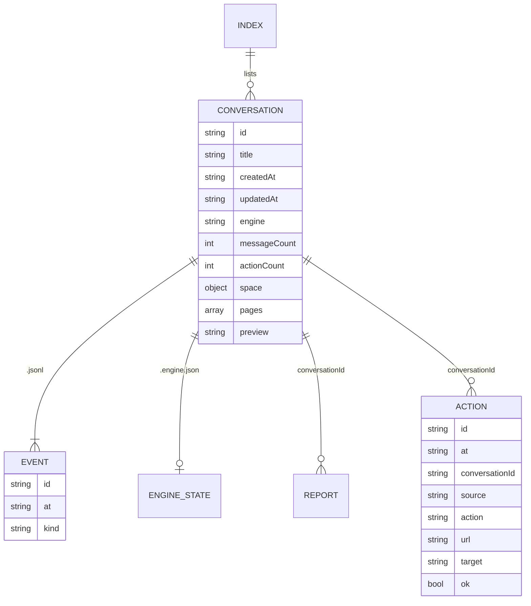
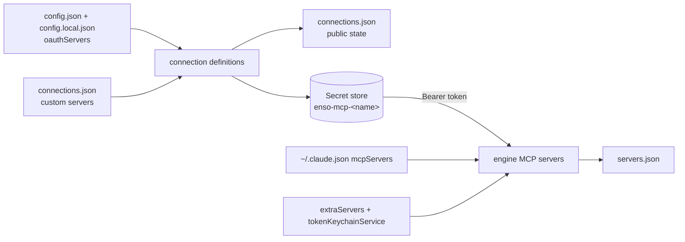

# Data model

Everything Ensō stores, where, and in what shape. Ensō has no database and no
server of its own: the helper writes plain files in one folder, secrets go to
the system's secret store (macOS Keychain, Linux keyring, Windows Credential
Manager), and the extension keeps a few UI preferences. Message shapes
(conversation events, settings, servers) are specified in [PROTOCOL.md](PROTOCOL.md).

## Contents

- [The data folder](#the-data-folder)
- [Conversations and events](#conversations-and-events)
- [The activity log](#the-activity-log)
- [Settings](#settings)
- [Configuration overlay](#configuration-overlay)
- [Profile and memory](#profile-and-memory)
- [Connections, servers and tokens](#connections-servers-and-tokens)
- [Secret store items](#secret-store-items)
- [Outside the data folder](#outside-the-data-folder)
- [Extension storage](#extension-storage)
- [The Zen Chat migration](#the-zen-chat-migration)
- [Backups and deleting data](#backups-and-deleting-data)

## The data folder

`dataDir()` in `helper/lib/platform.mjs` (override with `ENSO_DATA`; the older
`ZEN_CHAT_DATA` is still read). Written by `helper/lib/store.mjs` unless noted.

| System | Data folder | Log folder (`helper.log`) |
|---|---|---|
| macOS | `~/Library/Application Support/Enso` | `~/Library/Logs/Enso` |
| Linux | `$XDG_DATA_HOME/enso` (default `~/.local/share/enso`) | `$XDG_STATE_HOME/enso` (default `~/.local/state/enso`) |
| Windows | `%APPDATA%\Enso` | `%LOCALAPPDATA%\Enso\Logs` |

With `ENSO_DATA` set, logs go to `<data>/logs`; `ENSO_LOG_DIR` overrides both.

| Path | Format | What it holds | Written by |
|---|---|---|---|
| `profile.md` | Markdown | `# <name>`, then what you wrote about yourself. | Onboarding, Settings → You & memory |
| `memory.md` | Markdown | Global memory: one fact per line, `- <fact> (<YYYY-MM-DD>)`. | The `remember` tool, Settings → You & memory → Memory |
| `memory/<space-id>.md` | Markdown | Memory for one Zen space (the id with only letters, digits and `-` kept). | Same |
| `settings.json` | JSON | Your settings, merged over the defaults in `config.json` ([below](#settings)). | `settings.update`, approvals |
| `config.local.json` | JSON | Your overlay on the shipped `helper/config.json` ([below](#configuration-overlay)). | You, by hand |
| `conversations/index.json` | JSON | `{ conversations: [ConversationSummary] }`. | `store.mjs` |
| `conversations/<id>.jsonl` | JSON lines | One persisted event per line. | Every turn |
| `conversations/<id>.engine.json` | JSON | Engine state: the Claude Code `sessionId` (subscription), or `apiMessages`, the full Messages API history (API engine). | The engines |
| `actions.jsonl` | JSON lines | Every page action, session request, GitHub write and completed task, from Ensō and from MCP clients. | `logAction` |
| `reports/<uuid>.json` | JSON | `{ id, title, markdown, conversationId, createdAt }`. | `create_report` |
| `dashboard.json` | JSON | The last Home briefing, with `generatedAt`. | `dashboard.mjs` |
| `skills.json` | JSON | Your own slash commands `[{ name, description, prompt }]`. Absent until you add one. | Settings → Skills |
| `servers.json` | JSON | Last known status of each tool server (name, label, status, tool names, …), so the Tools page has something to show before the first chat. | `host.mjs` |
| `connections.json` | JSON | Public parts of OAuth connections: custom servers you added (name, URL, label), discovery metadata, connected/expired flags, `connectedAt`, `expiresAt`, the last OAuth callback port. No secrets. | `connections.mjs` |
| `mcp-token`, `mcp-token-read` | text, mode 0600 | Bearer tokens for the `zen-browser` MCP server: full access and read-only. 32 random bytes, hex. Created on first start. | `mcpauth.mjs` |
| `mcp-tools-cache.json`, `mcp-tools-cache-read.json` | JSON | The last `tools/list` the launcher forwarded for each scope, so clients see the tools while Zen is closed. | `mcplauncher.mjs` |
| `bin/enso` | shell script, 0755 | The `enso` command: `exec <node> <helper>/bin/enso.mjs "$@"`. | `install.sh`, `dev.sh`, or `enso mcp install` |
| `workspace/` | folder | The working directory of Claude Code sessions. Normally empty. | `store.mjs` |
| `helper/` | folder | The installed helper with `VERSION`. Replaced on every install; not data. | `install.sh` |
| `.migrated-from-zen-chat` | JSON | Marker of the one-time migration: source folder, time, items copied. | `store.mjs` |

Files are written in place, or through a `.tmp` file and a rename for JSON
documents that are rewritten whole (settings, index, reports, dashboard,
connections). Nothing in the folder is encrypted; it has your user account's
normal permissions, and the token files are 0600.

## Conversations and events



- `index.json` keeps one summary per conversation. `pages` holds the last 12
  pages that were in context or acted on; `preview` is the first line of the
  last answer (140 characters); `space` is the Zen space of the first message.
- Persisted event kinds: `user`, `assistant`, `thinking`, `tool.call`,
  `tool.result` (with a 600-character preview, not the full result),
  `approval.request`, `approval.resolved`, `page.action`, `notice`, `error`,
  `turn.start`, `turn.end` (with token usage and, on the subscription engine,
  cost). Streaming deltas are not stored. Fields per kind: [PROTOCOL.md](PROTOCOL.md#conversation-events).
- A `user` event stores your text, the page's URL and title (not its text),
  mentioned tabs' URLs and titles, attachment names and types, and whether a
  screenshot was attached. Page text, attachment contents and screenshots are
  sent to the engine but not written to the `.jsonl` file. The API engine's
  `apiMessages` history in `<id>.engine.json` does contain them, because it is
  the exact history sent back to the API on the next turn.
- Deleting a conversation removes its summary, `.jsonl` and `.engine.json`.
  Reports and actions that point at it are kept.

## The activity log

`actions.jsonl` is append-only and never trimmed. One line per action:

```json
{ "id": "…", "at": "2026-11-10T09:12:03.120Z", "conversationId": "…" | null,
  "source": "Codex", "client": "codex-mcp-client",
  "url": "https://…", "title": "…", "host": "example.com",
  "action": "click", "target": "button \"Register\"", "ok": true }
```

`source` and `client` are set for MCP callers (the client label and its raw
`clientInfo` name) and for the Tasks widget (`"Tasks widget"`). Actions include
page actions (`click`, `type`, `select`, `press`, `navigate`, `back`, `eval`,
`storage`), `session_fetch`, headless actions, GitHub writes and
`complete_task`. The Activity page and the `page_activity` tool read it.

## Settings

`settings.json` stores only what you changed; `getSettings()` merges it over
`defaults` from the config.

| Key | Default | Meaning |
|---|---|---|
| `engine` | `"subscription"` | `"subscription"` or `"api"`. |
| `model` | `"claude-opus-5-5"` | Model id for both engines and the dashboard. |
| `effort` | `"low"` | `"low"`, `"medium"` or `"high"`. |
| `includePageByDefault` | `true` | Whether the page chip starts on. |
| `autoApproveReadOnly` | `true` | Read-only third-party tools run without asking. |
| `alwaysAllowedTools` | `[]` | Full tool names (`mcp__<server>__<tool>`) you chose "Always allow" for. |
| `dashboard.autoRefreshMinutes` | `60` | How old the briefing may get. |
| `externalControl` | `"full"` | What MCP clients may do: `"full"`, `"read"` or `"off"`. |
| `developerTools` | on (unset) | `false` switches the console, network, eval, storage and session tools off. |
| `headless` | on (unset) | `false` switches the headless Zen off. |
| `sessionAccess` | `{}` | `{ "<origin>": "allow" }`: sites where Claude may use your signed-in session. |
| `serverOverrides` | `{}` | `{ "<server>": true | false }` from the Tools page switches. |
| `spaceHints` | `{}` | `{ "<space id>": "what this space is for" }` from Settings → You & memory. |
| `homeWidgets` | unset | The new-tab widget layout `[{ id, type, size }]`. |
| `onboardingDone` | unset | Set when onboarding is saved or skipped. |
| `claudePath` | unset | Path to the `claude` CLI, from Settings → Advanced → Claude Code location. |

## Configuration overlay

`helper/config.json` ships with the helper and is replaced on every update.
Personal configuration goes in `<data>/config.local.json`, merged by
`lib/config.mjs` when the helper starts (quit and reopen Zen after editing).
Every key is optional:

```json
{
  "servers": { "claude.ai Gmail": { "enabled": false }, "my-notes": { "enabled": true } },
  "extraServers": { "my-notes": { "type": "http", "url": "https://notes.example.com/mcp", "tokenKeychainService": "enso-notes-token" } },
  "oauthServers": { "fieldnotes": { "url": "https://fieldnotes.example.com/mcp", "label": "Fieldnotes" } },
  "catalog": { "my-notes": { "label": "Notes", "about": "My notes app.", "examples": ["What did I write about the launch?"] } },
  "spaceHints": { "Work": "My job at Northwind: Figma, Linear. Use my work accounts." },
  "sensitiveHosts": ["*.mybank.example"],
  "claudePath": "/opt/custom/bin/claude"
}
```

| Key | Merge rule |
|---|---|
| `defaults` | Shallow merge over the shipped defaults. |
| `servers` | Per server, merged (`{ "enabled": false }`). |
| `extraServers`, `oauthServers`, `spaceHints` | Added or replaced by name. |
| `sensitiveHosts` | Appended to the shipped list; it can't be shortened here. |
| anything else (`catalog`, `claudePath`, `webSearch`, `enableNewServers`, …) | Replaced. |

Keys starting with `//` and `$comment` are ignored. A file that isn't valid JSON
is ignored as a whole and the helper logs why. Space notes written in Settings
take precedence over `spaceHints`. Switches on the Tools page
(`serverOverrides` in `settings.json`) take precedence over `servers`.

Shipped values worth knowing: `webSearch: true`, `enableNewServers: false` (MCP
servers you add to Claude Code stay off for Ensō until enabled; claude.ai
connectors default to on), `zen-browser` off (so Ensō doesn't load its own MCP
server through Claude Code), and the private-site list in
[security.md](security.md#private-sites).

## Profile and memory

- `profile.md` is the first part of every system prompt. `saveProfile` caps the
  name at 80 characters and the text at 4000.
- `memory.md` follows it in the system prompt. The system prompt is part of
  the warm session's signature, so after a memory or profile change the next
  turn starts a fresh Claude Code session (resuming the same conversation).
- Space memory is not in the system prompt; it goes into each message's
  `<context>` block for conversations in that space.

## Connections, servers and tokens



- The OAuth client registration, access token and refresh token of each
  connection are one JSON record in the secret store item `enso-mcp-<name>`.
- `servers.json` is a cache for the UI; deleting it is harmless.
- `mcp-token` and `mcp-token-read` are re-read on every MCP request, so
  `enso mcp rotate` takes effect at once.

## Secret store items

`helper/lib/secrets.mjs` keeps items as (service, account) in the system's
store. Values never appear on a command line.

| System | Store | Access |
|---|---|---|
| macOS | login Keychain | `/usr/bin/security`; writes through `security -i` on stdin |
| Linux | libsecret (GNOME Keyring, KWallet, KeePassXC), attributes `service` and `account` | `secret-tool`, secret on stdin. Without `secret-tool`, a D-Bus session or a keyring: `<data>/secrets.json` (0600), with a warning in Setup and `enso doctor` |
| Windows | Credential Manager, generic credentials (target name = service, user name = account) | Windows PowerShell 5.1 calling `CredRead`/`CredWrite`/`CredDelete`, items as JSON on stdin |

`ENSO_SECRETS=keychain|libsecret|credman|file` forces a backend (tests, CI).

| Service | Account | What | Set by |
|---|---|---|---|
| `enso-anthropic` | `enso` (a read matches any account) | Anthropic API key for the API engine. | Settings → Setup → Claude, or by hand: `security add-generic-password -s enso-anthropic -a enso -w` (macOS), `secret-tool store --label=Ensō service enso-anthropic account enso` (Linux), `cmdkey /generic:enso-anthropic /user:enso /pass` (Windows) |
| `zen-chat-anthropic` | any | Legacy name, read when `enso-anthropic` is missing. | Older installs |
| `enso-github` | `enso` | GitHub token, when you don't use the GitHub CLI. | Tools → GitHub (checked against GitHub first) |
| `enso-mcp-<name>` | `enso` | OAuth record for a connected MCP server. Values longer than one item holds (about 3000 characters in the Keychain, 6000 with libsecret, 1800 in Credential Manager) are base64-encoded and split over `enso-mcp-<name>`, `enso-mcp-<name>~1`, `~2`, …; the head item starts with `enso1:<count>:`. | Connect on the Tools page |
| `enso-t3` | `enso` | T3 Code session token, its id and expiry. | `enso t3 connect`, Settings → Send screenshots |
| the name in `tokenKeychainService` | any | Bearer token for an `extraServers` entry. | You |

## Outside the data folder

| Where | What | Notes |
|---|---|---|
| macOS: `~/Library/Application Support/Mozilla/NativeMessagingHosts/enso.json`, `~/Library/Application Support/zen/NativeMessagingHosts/enso.json` | Native-messaging manifests. | `install.sh`, `dev.sh` |
| Linux: `~/.mozilla/native-messaging-hosts/enso.json`, `~/.zen/native-messaging-hosts/enso.json` | Native-messaging manifests. Zen reads Mozilla's folder for now (zen-browser/desktop#10622). | `install.sh`, `dev.sh` |
| Windows: `HKCU\Software\Mozilla\NativeMessagingHosts\enso` | Registry key whose default value is `%APPDATA%\Enso\enso.json` (the manifest lives in the data folder). Zen reads Mozilla's key. | `install.ps1` |
| `~/.local/bin/enso` (macOS, Linux) | Symlink to `bin/enso`, when `~/.local/bin` exists (created on Linux) and the name is free. | `install.sh`, `dev.sh` |
| Windows user `PATH` | `%APPDATA%\Enso\bin` (holds `enso.cmd` and `run.cmd`), unless `ENSO_NO_PATH=1`. | `install.ps1` |
| `~/.claude/projects/<encoded path of Enso/workspace>/` | Claude Code's own transcripts of subscription-engine conversations (Claude Code persists sessions so they can be resumed). The dashboard run is not persisted. | Claude Code |
| `~/.claude.json`, `~/.codex/config.toml`, `~/.cursor/mcp.json`, `~/.config/opencode` (same paths under the home folder on every OS) | The `zen-browser` registration (on Windows as `node.exe <data>\helper\bin\enso.mjs mcp`, not the `.cmd` shim), plus backups `*.enso-backup-<time>` (0600) of files `enso mcp install` changed. | `enso mcp install` |
| System temp folder, `enso-headless-*` | Temporary headless Zen profile, with copied cookies when sites were given. | Deleted on stop, idle timeout, helper exit, or the next start. |

Ensō reads, but never writes: Zen's `installs.ini` and `zen-sessions.jsonlz4`
(spaces), the live profile's `cookies.sqlite` (copied for the headless Zen),
and `~/.claude.json` (Claude Code's MCP servers). Zen's profiles are in
`~/Library/Application Support/zen` on macOS, `~/.zen` on Linux (Flatpak:
`~/.var/app/app.zen_browser.zen/.zen`) and `%APPDATA%\zen` on Windows.

## Extension storage

The extension keeps no conversation data. The UI stores a few preferences in
`localStorage` of the extension's origin:

| Key | What |
|---|---|
| `enso.homeWidgets` | Widget layout (fallback; the helper's `settings.homeWidgets` wins). |
| `enso.doneItems` | Items ticked off locally in Due soon and Tasks. |
| `enso.quickLinks` | The Quick links widget. |
| `enso.note` | The Note widget's text. |
| `enso.tasksWidgetAdded` | One-time flag: Tasks was added next to Due soon. |
| `enso.tools.hidden` | "Hide your tools" on the new tab. |
| `enso.scope` | History scope: this space or all. |
| `enso.context` | Whether the full page's context column is hidden. |
| `enso.tips.dismissed` | Dismissed tips. |

`background.js` keeps the network log (500 requests per tab) and console
entries (1000 per tab) in memory only; they are gone when Zen quits. The
`storage` permission is declared but not used.

## The Zen Chat migration

Before 0.5.0 the product was called Zen Chat and kept its data in
`~/Library/Application Support/zen-chat/` (macOS only; there is nothing to
migrate on Linux and Windows). On first start, `migrateLegacyData`
copies these items into the new folder, once:

`conversations`, `memory`, `memory.md`, `profile.md`, `reports`,
`actions.jsonl`, `settings.json`, `servers.json`, `connections.json`,
`skills.json`, `mcp-token`, `dashboard.json`

It runs only when the old folder exists and the new one has neither the
`.migrated-from-zen-chat` marker nor `conversations/index.json`. Items already
present in the new folder are kept. The old folder is only read. Copying
`mcp-token` keeps an existing `zen-browser` registration working. The API
engine still reads the old Keychain item `zen-chat-anthropic`. With
`ENSO_DATA` set, only an explicit `ENSO_LEGACY_DATA` is migrated.

## Backups and deleting data

The data folder is part of your backups (Time Machine, File History, …) like
any other folder. To remove everything Ensō stored on macOS:

```sh
enso mcp uninstall                                      # if you registered MCP clients
rm -rf ~/Library/Application\ Support/Enso ~/Library/Logs/Enso
rm -f ~/Library/Application\ Support/{Mozilla,zen}/NativeMessagingHosts/enso.json ~/.local/bin/enso
security delete-generic-password -s enso-anthropic      # if you used an API key
security delete-generic-password -s enso-github         # if you saved a GitHub token
```

On Linux, remove `~/.local/share/enso`, `~/.local/state/enso`, the two
`enso.json` manifests and `~/.local/bin/enso`, and clear the items with
`secret-tool clear service enso-anthropic` (and `enso-github`). On Windows,
remove `%APPDATA%\Enso`, `%LOCALAPPDATA%\Enso`, the registry key
`HKCU\Software\Mozilla\NativeMessagingHosts\enso` and `%APPDATA%\Enso\bin`
from the user PATH, and run `cmdkey /delete:enso-anthropic` (and
`enso-github`). The user guide has the commands:
[install.md](../site/content/docs/install.md#uninstalling).

Disconnect OAuth servers on the Tools page first, so their tokens are revoked
and their secret store items removed. Claude Code's transcripts of Ensō
conversations are in `~/.claude/projects/` (the folder whose name ends in
`Enso-workspace`).
