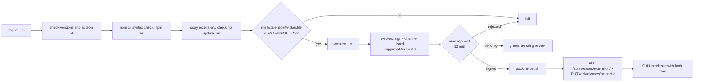

# Releasing

How a version of Ensō gets from a tag to people's Macs: the version bump, the
release workflow, signing on addons.mozilla.org (AMO), the site's update feed,
and how installed copies update. Why it is done this way:
[records/007-listed-amo-channel.md](records/007-listed-amo-channel.md) (and,
for the update feed, [004](records/004-unlisted-amo-signing.md)).

## Contents

- [Versions](#versions)
- [Cutting a release](#cutting-a-release)
- [What the release workflow does](#what-the-release-workflow-does)
- [The site's side](#the-sites-side)
- [How installed copies update](#how-installed-copies-update)
- [The installer](#the-installer)
- [The AMO listing](#the-amo-listing)
- [Re-publishing and fixing a release](#re-publishing-and-fixing-a-release)
- [Checklist](#checklist)

## Versions

The extension and the helper are released together with one version number,
kept in two places:

- `version` in `extension/manifest.json`;
- `version` in `helper/package.json` (and `package-lock.json`).

CI fails when they differ, and the release workflow refuses a tag that doesn't
match both. Use plain `MAJOR.MINOR.PATCH`. Firefox compares versions
numerically, so `0.5.10` is newer than `0.5.9`.

During development, bump the manifest version whenever you want Zen to take a
new dev build (see [development.md](development.md#after-a-change)), and keep
`helper/package.json` in step before merging.

## Cutting a release

1. Update [CHANGELOG.md](../CHANGELOG.md).
2. Bump both versions and commit ("Ensō 0.5.3").
3. Tag and push:

   ```sh
   git tag -a v0.5.3 -m "Ensō 0.5.3"
   git push origin main v0.5.3
   ```

4. Watch the **Release** workflow in GitHub Actions. It submits a listed
   version to AMO and waits up to 12 minutes for the signature. If AMO signs it
   in time, it publishes everything. If the version is queued for review, the
   run ends green with "submitted, awaiting review" in its summary; after AMO
   approves it (email from AMO, or `node amo/amo.mjs status <version>`), run
   **Release** by hand with the tag and mode **publish-approved**.
5. Check the result:

   ```sh
   curl -fsS https://enso.wicker.life/api/latest
   curl -fsS https://enso.wicker.life/updates.json
   ```

## What the release workflow does

`.github/workflows/release.yml` runs on `v*` tags, or by hand
(`workflow_dispatch`) for an existing tag, on `macos-latest` with Node 22. One
release runs at a time.



Modes (`workflow_dispatch` input `mode`; a tag push is `submit-listed`):

| Mode | What |
|---|---|
| `submit-listed` | Submit the tag's version as listed (skipped when AMO already has it), wait, publish if signed. |
| `publish-approved` | No submission: check the version on AMO, download the signed `.xpi`, build the helper, publish both. Use it after a review. |
| `submit-unlisted` | Emergency only: sign as unlisted with `update_url` injected, publish. That version number is then used up on AMO. |

1. **Versions.** The tag without `v` must equal the manifest and helper
   versions; the manifest id must be `enso@wicker.life`.
2. **Helper checks.** `npm ci --omit=optional`, `node --check` on every module,
   `npm test`.
3. **Prepare the extension.** Copies `extension/` to `build/extension`. Listed:
   fails if the manifest has an `update_url` (AMO refuses it). Unlisted: sets
   `update_url` to `https://enso.wicker.life/updates.json`.
4. **Site check.** Reads `extensionIds` from `/api/latest` and fails if
   `enso@wicker.life` isn't there: self-hosted copies would never be offered
   the update.
5. **Lint.** `web-ext lint` (`--self-hosted` for unlisted).
6. **Submit.** `amo/amo.mjs metadata` writes the `--amo-metadata` file (licence
   MIT, reviewer notes from `amo/approval-notes.md`, release notes from this
   version's CHANGELOG section), then `web-ext sign --channel listed
   --approval-timeout 0` uploads and submits without waiting.
7. **Wait.** `amo/amo.mjs wait <version> --minutes 12 --out dist/enso-<version>.xpi`
   polls `GET /api/v5/addons/addon/enso@wicker.life/versions/<version>/` and
   downloads the signed file when its status is `public`. It sets the step
   output `status` to `signed`, `pending` or `rejected`.
8. **Check the signed file.** The version matches and the `.xpi` carries
   Mozilla's signature.
9. **Helper tarball.** `scripts/pack-helper.sh <version> dist` copies
   `helper/` without `node_modules`, `test/` and `run.sh`, installs production
   dependencies without optional ones (so no ~200 MB Claude Code binary), fails
   on any file over 20 MB, writes `VERSION`, and produces
   `dist/enso-helper-<version>-darwin.tar.gz`. CI keeps it under 40 MB; 0.5.2
   was about 8.6 MB.
10. **Publish.** `PUT https://enso.wicker.life/api/releases/<kind>/<version>`
    with the file as the body and `Authorization: Bearer $ENSO_RELEASE_TOKEN`;
    the extension upload carries `?strict_min_version=139.0`. Then checks that
    `/updates.json` offers the version.
11. **GitHub release.** Creates `v<version>` with both files and generated
    notes, or uploads to an existing one (`--clobber`).

Repository secrets:

| Secret | What |
|---|---|
| `AMO_JWT_ISSUER`, `AMO_JWT_SECRET` | addons.mozilla.org API credentials (Developer Hub → API keys). |
| `ENSO_RELEASE_TOKEN` | Same value as `RELEASE_TOKEN` on the site. |

## The site's side

The site (`site/` in this repository, deployed by Coolify when `site/` changes on `main`) stores releases in
its `releases` table and object storage:

| Route | What |
|---|---|
| `PUT /api/releases/:kind/:version` | CI uploads an `extension` (.xpi) or `helper` (tarball). Bearer `RELEASE_TOKEN`. |
| `GET /api/latest` | `{ extension: { version, url, sha256, size, publishedAt }, helper: {…}, extensionIds }`. The installer reads the helper's URL and SHA-256 from it. |
| `GET /updates.json` | Firefox's update manifest: for each id in `EXTENSION_IDS`, every non-yanked extension release with `update_link`, `update_hash` (`sha256:…`) and `strict_min_version`. Cached 5 minutes. |
| `GET /releases/<file>` | Downloads. `enso-latest.xpi` and `enso-helper-latest-darwin.tar.gz` redirect to the newest version. |
| `GET /install.sh` | The installer, `site/static/install.sh` (`scripts/install.sh` is a symlink to it). |

`EXTENSION_IDS` is a site environment variable (default `enso@wicker.life`);
production lists `zen-chat@wicker.life,enso@wicker.life`, the old id serving
pre-release Zen Chat builds. Details are in [site/docs/HOSTING.md](../site/docs/HOSTING.md).

## How installed copies update

- **The extension** updates itself. Copies installed from AMO, and every copy
  from 0.5.5 on, update from AMO like any listed add-on. Copies installed from
  enso.wicker.life before 0.5.5 have `update_url` (the site's `/updates.json`):
  Zen downloads the newest `.xpi` from the site, verifying the SHA-256, and
  since that file is the listed one without `update_url`, their later updates
  come from AMO. If a new version asks for more permissions or data
  collection, Zen asks the user first.
- **The helper** does not update itself. Users run the installer again. The
  installer replaces `Enso/helper` in one move and keeps the data folder. The
  running helper keeps its old code until Zen is restarted.

So after a release, people can run a new extension against an older helper
until they reinstall. Keep the protocol backwards compatible within a minor
version: new message types and fields are fine; changed or removed ones need a
helper update and a note in the changelog.

## The installer

There is one installer: `site/static/install.sh`, which the site serves as
`/install.sh`. `scripts/install.sh` is a symlink to it, so editing either path
changes the same file, and the change goes live when the site deploys.

The installer's environment overrides (`ENSO_SITE`, `ENSO_HELPER_URL`,
`ENSO_EXTENSION_ID`, `ENSO_SKIP_CHECKSUM`, `ENSO_REGISTER_MCP`, `ENSO_NO_OPEN`)
are documented at the top of the script. `ENSO_HELPER_URL` with a local
tarball is a quick way to test a release candidate:

```sh
scripts/pack-helper.sh 0.5.3-rc1 dist
ENSO_HELPER_URL="file://$PWD/dist/enso-helper-0.5.3-rc1-darwin.tar.gz" ENSO_NO_OPEN=1 bash scripts/install.sh
```

## The AMO listing

Everything shown on <https://addons.mozilla.org/firefox/addon/enso/> is in
`amo/`:

| File | What |
|---|---|
| `listing.json` | Name, slug, summary (250 characters at most), categories, licence, links, flags, and which files below to use. |
| `description.md` | The description (AMO renders a little Markdown). |
| `approval-notes.md` | Notes for AMO's reviewers, attached to every submitted version. |
| `icon-128.png`, `previews/*.png` | Icon and screenshots (1280×800, taken headlessly from the mock UI). |
| `amo.mjs` | The AMO v5 API client: `listing`, `metadata`, `wait`, `status`. |

The privacy policy on AMO is generated from `site/content/privacy.md`. To
change the listing, edit these files, merge, and run the **AMO listing**
workflow (Actions → AMO listing → Run workflow; tick *icon*, or choose *previews* "missing" or "replace", to
upload those too). `node amo/amo.mjs listing --dry-run` prints what it would
send, without credentials. The credentials are only in the repository secrets.

AMO throttles writes per hour (around ten). A run that hits the hourly limit
fails with "run it again later"; run it again an hour later with previews
"missing", which uploads only the screenshots that aren't there yet. Don't
run it just before tagging a release, which needs a few writes too.

## Re-publishing and fixing a release

- **Re-run** a release for an existing tag from the Actions tab (Release → Run
  workflow → `tag`, mode). AMO refuses the same version twice, so
  `submit-listed` skips the submission when AMO already has the version and
  only waits; use `publish-approved` once it is signed.
- **A bad release:** release a higher patch version. The site's table has a
  `yanked` column that hides a release from `/updates.json`, `/api/latest` and
  downloads. There is no endpoint for it; set it with SQL on the site's
  database (`UPDATE releases SET yanked = true WHERE filename = '…'`). Copies
  that already updated stay on the bad version until the next release.
- Never reuse or move a tag that was published.

## Checklist

- [ ] CHANGELOG.md updated.
- [ ] `extension/manifest.json` and `helper/package.json` at the new version.
- [ ] CI green on `main`.
- [ ] If the user-visible behaviour changed: `site/content/docs/` updated.
- [ ] Tag pushed; Release workflow green (if "awaiting review": run
      `publish-approved` after AMO approves it).
- [ ] `/api/latest` and `/updates.json` show the version.
- [ ] Installer run on a Mac; extension updated in Zen (Add-ons → Check for updates).
